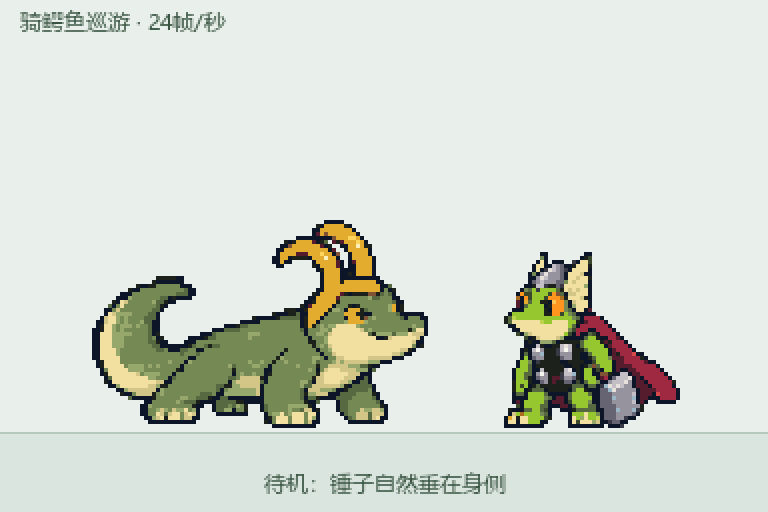
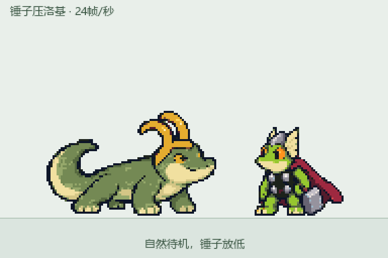
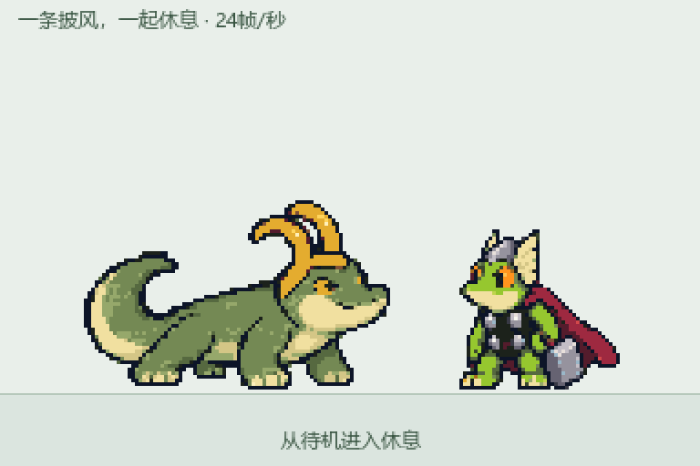
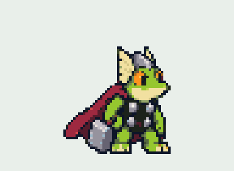

# 洛基与雷神 · 像素桌宠

两只会在 Windows 和 macOS 桌面上独立巡游、碰面玩闹的像素小伙伴：鳄鱼洛基与青蛙雷神。

**Windows：v0.10.0；Mac：v0.10.1 预览版。** 透明背景、右键点播、鼠标拖动、短促街机音效。



## 下载与运行

| 你的电脑 | 下载 |
| --- | --- |
| Windows | [Windows 运行包](https://github.com/EDWARDEDISON/loki-throg-desktop-pets/releases/tag/v0.10.0) |
| Mac（Apple 芯片 / Intel） | [Mac 通用预览版](https://github.com/EDWARDEDISON/loki-throg-desktop-pets/releases/tag/v0.10.1-macos.1) |

### Windows

1. 打开 **[下载页 / Releases](https://github.com/EDWARDEDISON/loki-throg-desktop-pets/releases/latest)**，下载 `LokiThrogPets-v0.10.0-windows-x64.zip`。GitHub 自动附带的 “Source code” 是源码包。
2. 解压到自己的文件夹。如果旧版还在运行，先从系统托盘退出旧版。
3. 双击 `LokiThrogPets.exe`。
4. 退出时，右键角色或系统托盘图标，选择「退出桌宠」。

适用环境：Windows 桌面，依赖系统自带的 .NET Framework 4.x；目前在 Windows 11 上验证。程序不联网、不设置开机启动、不需要安装 Python。EXE 尚未进行代码签名；如果系统提示阻止运行，请先核对发布来源和 SHA-256，不需要关闭系统防护。

### Mac

下载 **LokiThrogPets-v0.10.1-macos-universal.zip**，解压得到 **LokiThrogPets.app**，可拖入「应用程序」后双击。一个包同时支持 Apple M 系列和 Intel，目标系统为 macOS 11 及以上；已在 macOS 15 的两种架构中完成编译、自检与原生透明窗口启动验证。

菜单栏的 **🐊🐸** 图标可以调声音、暂停和退出；角色菜单支持触控板两指点按、鼠标右键或 Control + 点击。无需额外安装运行环境，也无需辅助功能或屏幕录制权限。

Mac 版仍是预览版，欢迎实机反馈不同显示器、Spaces、全屏应用和操作手感。当前使用 ad-hoc 签名检查包完整性，尚未经过 Apple Developer ID 签名和公证；首次打开可能被系统拦下，请核对发布来源和 SHA-256，并参考 [Apple 官方说明](https://support.apple.com/en-us/102445)由本人决定是否允许打开，无需关闭系统防护。详见 [Mac 使用说明](macos/使用说明.md)。

## 它们会做什么

- **各自活动**：朝当前屏幕的远端巡游，途中短暂休息，到边缘再折返。
- **碰面互动**：12 种双人动画等概率选择，包含锤子压洛基、骑鳄鱼、变蛇恶作剧、咬住飞锤、尾巴秋千、分享零食和一起盖披风休息。
- **单人表演**：每只各有 12 种动作；没有碰面时，每 3～5 分钟随机表演。包括洛基变装毒液、奇异博士、洗澡、比心，以及雷神召锤、起飞、小雷雨、比心等。
- **右键点播**：可以选择自己的动作，也可以主动去找哥哥 / 弟弟，进行指定或随机互动。
- **拖动与回应**：轻点会回应；拎起来会蹬腿，放下时有缓冲。
- **声音**：14 种原创合成的短音效，默认音量 25%；右键全局设置可以调音量、静音，偏好会记住。







表演图集统一为 24 帧/秒、2 像素逻辑网格，显示时使用最近邻放大。GIF 预览的时间精度有限；[带音效的雷神拖拽 MP4](docs/media/frog-pickup.mp4) 为精确 24 帧/秒。

更多操作见[完整使用说明](docs/USER_GUIDE.zh-CN.md)，动作列表见[动作目录](docs/action-catalog.json)。

## 从源码编译

需要 Windows、Windows PowerShell 和系统的 .NET Framework C# 编译器。资源已经包含在仓库中，编译不需要联网。

```powershell
.\tools\build.ps1
.\bin\LokiThrogPets.exe
```

运行引擎自检和制作运行包：

```powershell
.\tools\test.ps1
.\tools\package.ps1
```

输出分别在 `bin/`、`artifacts/test/` 和 `dist/`。运行包将图片和音效嵌入 EXE，使用者无需另行放置素材。

Mac 原生实现使用 Swift / AppKit，在有 Xcode Command Line Tools 的 Mac 上执行 `bash macos/build.sh` 即可构建通用 `.app`；详见 [Mac 编译与测试说明](macos/README.md)。

| 路径 | 内容 |
| --- | --- |
| `src/` | Windows Forms 原生透明窗口、行为调度与音效源码 |
| `assets/` | 454 张 PNG，包含 36 张完整透明动画图集 |
| `sounds/` | 14 段原创合成的 PCM WAV |
| `docs/timelines/` | 全部 36 组动作的逐帧记录 |
| `docs/design/` | 像素形象参考、补绘提示词与调色记录 |
| `docs/validation/` | v0.10 的引擎自检与启动记录 |
| `tools/` | 编译、自检和打包脚本 |
| `macos/` | Swift / AppKit 原生 Mac 实现及通用包构建脚本 |

## 反馈问题

欢迎在 [Issues](https://github.com/EDWARDEDISON/loki-throg-desktop-pets/issues) 反馈。请附上版本、Windows 版本、显示缩放比例，以及问题发生前的操作；画面问题尽量提供短视频或截图。提交前请遮住桌面上的个人信息。改进建议也欢迎！

验证情况：已检查全部 8,736 帧与行为调度；开启自动互动的 10 分钟引擎模拟发生 10 次双人互动，两只均能抵达屏幕两端。尚未在所有 Windows 版本、显示器布局和音频设备上验证。

## 创作与权利说明

这是一个**非官方粉丝项目**，与 Marvel、Disney 无隶属或赞助关系。角色名称、形象及相关权利归其原权利人所有。

动画由创作者构思并多轮审阅，Codex 协助编程，图像采用 AI 辅助补绘、统一调色和程序逐帧合成，音效由程序原创合成。仓库不包含最初收集的漫画截图、商品照片或聊天记录。

源码目前公开供查看和讨论，尚未指定通用开源许可证；素材及角色权利也不由代码授权替代。详见 [NOTICE](NOTICE.md)。
